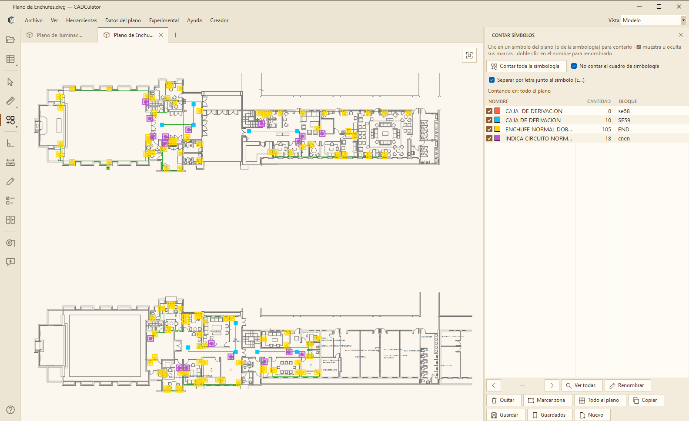
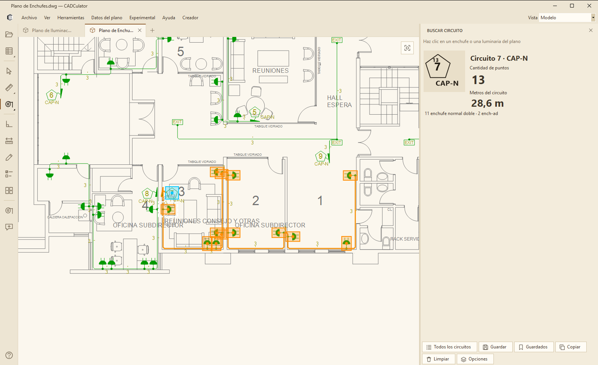
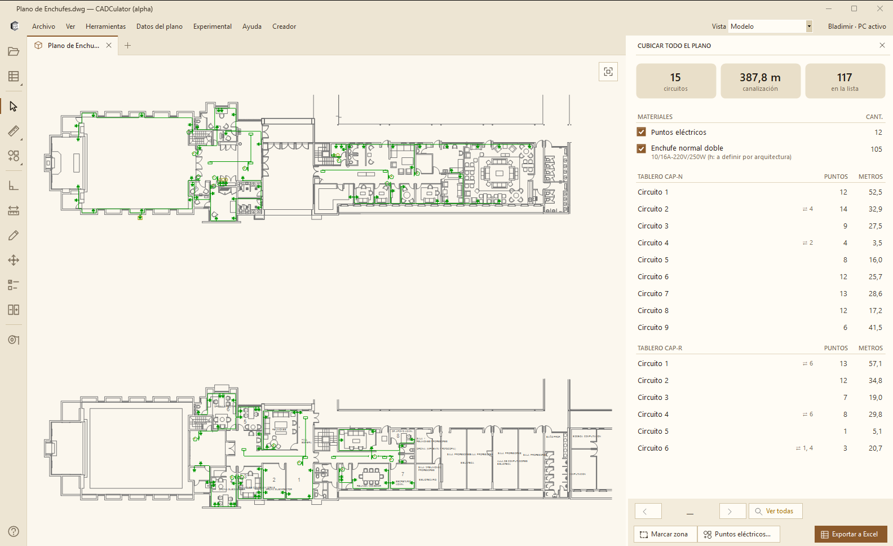
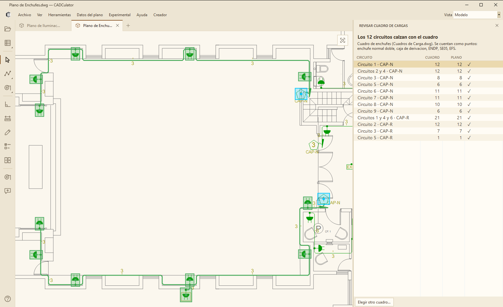
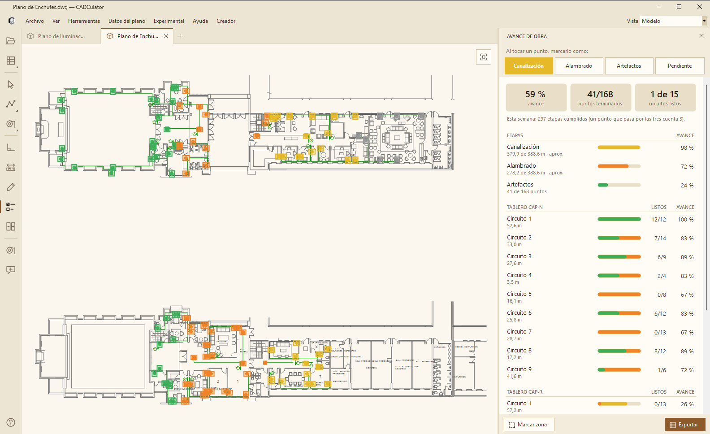
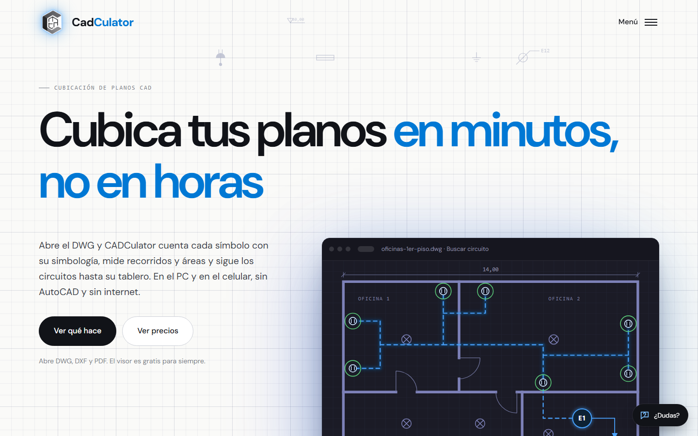

# CADCulator

**Software para leer planos eléctricos y cubicar instalaciones** — abre archivos DWG y DXF, cuenta símbolos, sigue circuitos y calcula metros de canalización, en PC y Android.

Producto comercial propio, en producción, con sitio web, suscripciones y pago real integrado: [cadculator.cl](https://cadculator.cl). Nació de un problema de terreno: el autor también es electricista, con 10 años de oficio, y sabía cuánto tiempo se pierde contando puntos a mano.

Este repositorio muestra cómo está construido, con qué tecnologías y qué hace. El código fuente no está incluido (ver [Licencia](#licencia)).

---

## Capturas de pantalla

### Contar símbolos

Un clic en un símbolo del plano o de su simbología cuenta todas las copias, con sus marcas sobre el dibujo.



### Buscar circuito

Un clic en un enchufe o luminaria muestra su circuito completo, con la cantidad de puntos y los metros.



### Cubicar todo el plano

Resumen de materiales, circuitos por tablero y metros de canalización, exportable a Excel.



### Revisar el cuadro de cargas

Compara el cuadro de cargas con lo que realmente está dibujado en el plano, circuito por circuito.



### Avance de obra

Marca cada punto por etapa (canalización, alambrado, artefactos) y calcula el avance por circuito y por tablero.



### Sitio web

Sitio comercial con cuentas de usuario, descargas, carrito y suscripciones.



---

## Lenguaje y plataforma

| | PC | Android | Sitio web |
|---|---|---|---|
| Lenguaje | **C#** | **C#** | **C#**, HTML, CSS, JavaScript |
| Plataforma | **.NET 8**, Windows 10/11 x64 | **.NET 10** para Android | **.NET 10** |
| Interfaz | **Windows Forms**, con visor 2D y temas propios | Vistas nativas de Android, con visor propio | **ASP.NET Core Razor Pages** |
| Datos | Archivos locales por plano | Almacenamiento local de la app | **SQLite** con **Entity Framework Core** |
| Entrega | Publicación **self-contained** e instalador **Inno Setup** | APK firmado | **Docker** en VPS con **Dokploy** |

### Bibliotecas y servicios

| Componente | Uso |
|---|---|
| `ACadSharp` | Lectura de archivos DWG y DXF |
| `ClosedXML` | Exportación a Excel |
| `ExcelDataReader` | Lectura de planillas Excel |
| `PDFsharp` | Generación de PDF |
| Google | Inicio de sesión en el sitio |
| Flow.cl | Pagos en línea |

---

## Arquitectura

```
Programa de PC          Interfaz Windows Forms, visor 2D y herramientas
        |
Núcleo de planos        Lectura del dibujo, conteo, circuitos, cubicación y cuadros
        |
App Android             Interfaz nativa que reutiliza el núcleo en C#

Sitio web               Cuentas, tienda, suscripciones, descargas y panel de administración
        ^
        |               Inicio de sesión y permiso de uso firmado
Programa de PC y app
```

### Decisiones técnicas destacables

- **Planos reales, no planos ideales**: cada dibujante trabaja distinto. Los errores se resuelven con reglas generales, y un plano mal dibujado nunca se convierte en regla para los demás.
- **Comparación contra un conjunto de planos**: antes de publicar una regla, se comparan materiales, circuitos, puntos y metros en 96 planos reales para detectar efectos no deseados.
- **Revisor automático**: en vez de revisar plano por plano, una herramienta propia busca resultados que no cuadran para que una persona los confirme.
- **Sin adivinar**: si un plano es ambiguo, el programa lo avisa en lugar de inventar un resultado.
- **Suscripciones sin claves manuales**: inicio de sesión desde el navegador, un equipo por suscripción y permisos firmados digitalmente (ECDSA) que permiten trabajar hasta 7 días sin internet.
- **Secretos fuera del código**: las credenciales de producción viven solo en el entorno del servidor.
- **Versión de desarrollo separada**: las herramientas internas de diagnóstico existen solo en esa versión, y antes de publicar se comprueba que no lleguen al instalador.

---

## Funcionalidades

- **Visor gratuito**: abre planos y permite moverse y hacer zoom, sin publicidad.
- **Contar**: símbolos automáticos, conteo a mano y separación por letra junto al símbolo.
- **Buscar circuito**: puntos, metros y detalle de cada circuito.
- **Cubicar**: materiales y circuitos de todo el plano o de una zona.
- **Cuadro de cargas**: comparación entre el cuadro y el dibujo.
- **Medir**: distancias con tramos y escala calibrada.
- **Avance de obra**: seguimiento por etapa, circuito y tablero.
- **Tablas a Excel**: extracción de tablas dibujadas en el plano.
- **Editar y rayar**: anotaciones y copias sobre el plano.
- **Cuenta y suscripción**: compra en línea, descarga y actualizaciones desde el programa.

---

## Autor

**Bladimir López** — Ingeniero Informático y electricista  
Terreno Digital SpA · [cadculator.cl](https://cadculator.cl) · contacto@cadculator.cl

---

## Licencia

El código fuente **no** está incluido en este repositorio: CADCulator es un producto de software propietario. Ver [LICENSE](LICENSE).
